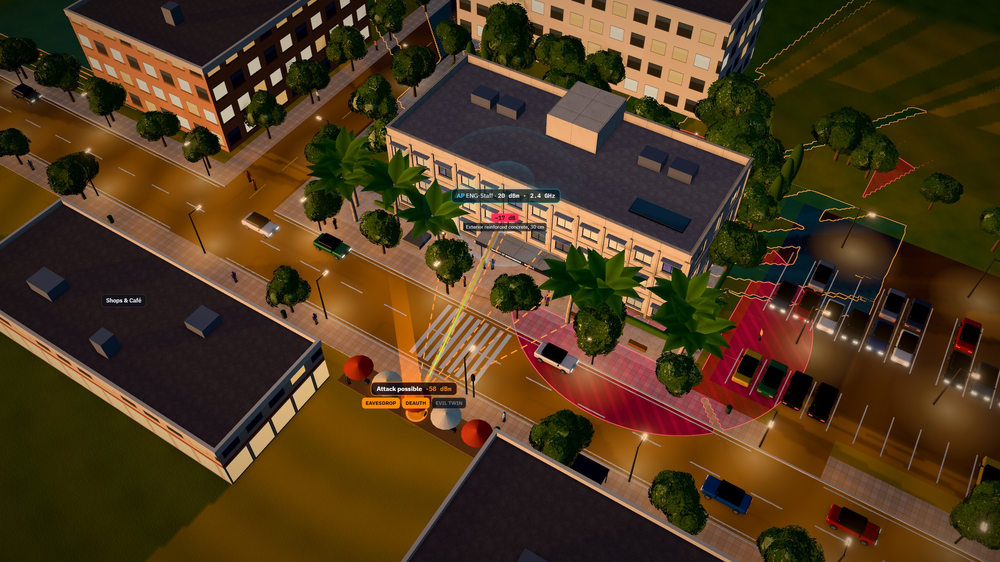
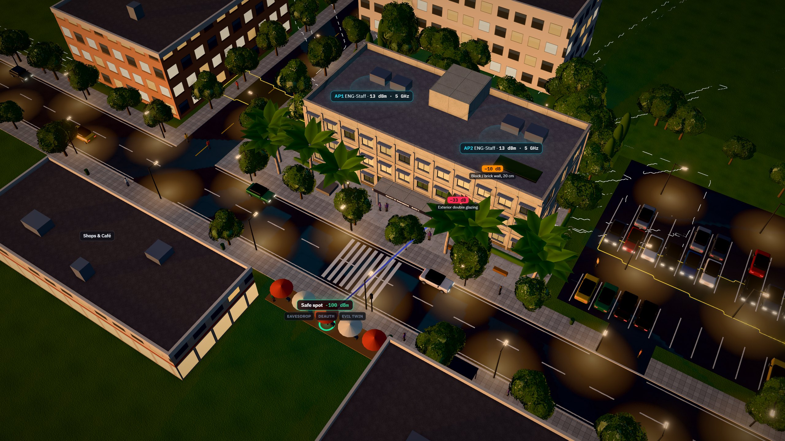
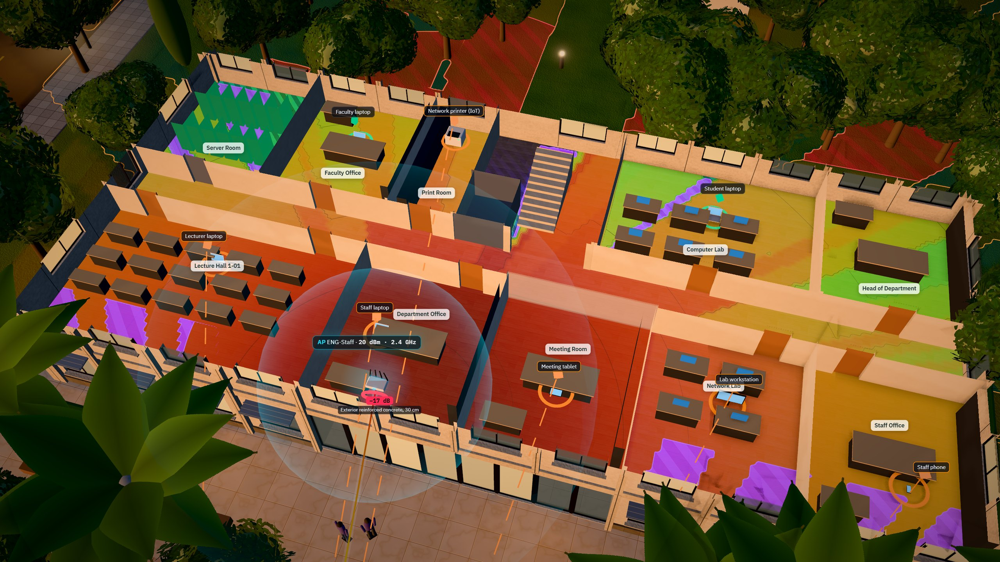
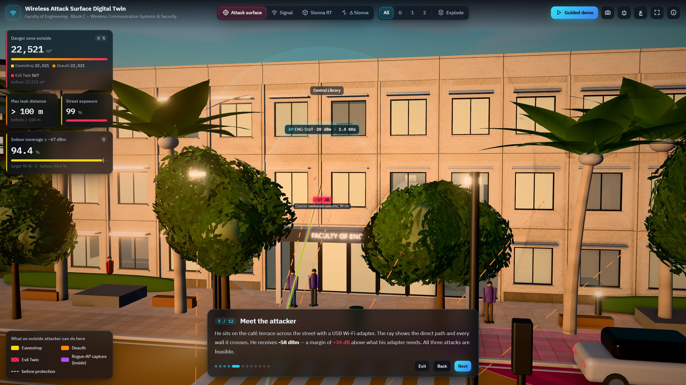
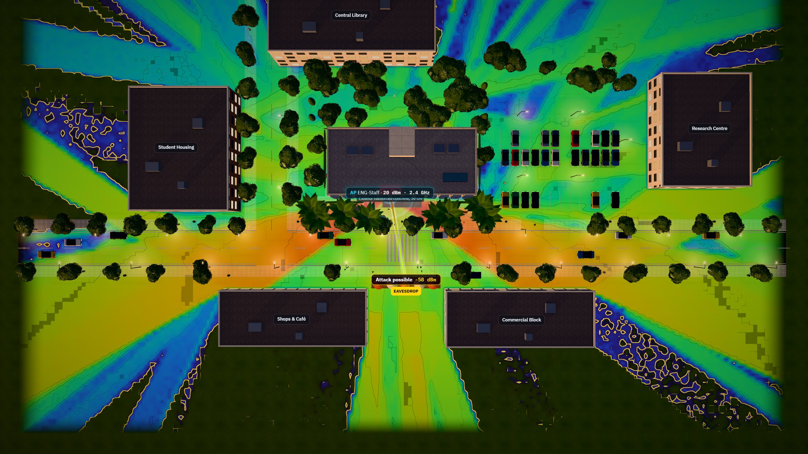

<div align="center">

# Wireless Attack Surface Digital Twin
### التوأم الرقمي لسطح الهجوم اللاسلكي

**Where can an outside attacker reach a building's Wi-Fi from — and how far can we shrink that zone?**

[**▶ Open the live 3-D twin**](https://owaisabusalah.github.io/wireless-attack-surface-twin/) ·
[Presentation](presentation/Wireless_Attack_Surface_Digital_Twin.pptx) ·
[Report (PDF)](docs/REPORT.pdf) ·
[Model specification](docs/MODEL.md) ·
[Simulation results](sim/out/RESULTS.md)



*Course project — Wireless Communication Systems & Security · Owais Abu Salah · November 2026*

</div>

---

## What it is

A **3-D digital twin** of a three-storey faculty building, its street, café, parking lot and neighbours.
It simulates how the building's Wi-Fi propagates — through walls, windows, doors and floor slabs — and turns
the received power into a **map of the attack surface**: every outdoor spot where an attacker can

| | Attack | Condition used by the twin |
|---|---|---|
| 🟨 | **Eavesdropping** (capture traffic and the WPA2 handshake) | the attacker hears the AP above his receiver's sensitivity |
| 🟧 | **Deauthentication** (forged management frames) | he hears the network **and** his frames reach a client at ≥ −88 dBm |
| 🟥 | **Evil Twin** (rogue AP with the same SSID) | he hears the network **and** beats the real AP at a client by 3 dB (≥ −75 dBm) |

You can **walk the attacker around**, **drag the access points**, and **apply protections** — shielding film and
paint, relocation, micro-cells, directional antenna, 5 GHz, TX-power tuning, 802.11w and WPA3 — and watch the
danger zone shrink live, while a KPI panel keeps an eye on indoor coverage.

<table>
<tr>
<td width="50%"><br><sub><b>After “Apply protection”</b>: danger zone −99 %, street exposure 0 %, coverage kept.</sub></td>
<td width="50%"><br><sub><b>Inside floor 1</b>: purple = where clients would join the attacker's rogue AP.</sub></td>
</tr>
<tr>
<td><br><sub><b>Guided demo</b> (press <kbd>T</kbd>) with the attacker's link budget, live numbers.</sub></td>
<td><br><sub><b>NVIDIA Sionna RT</b> ray-traced map of the same building, for validation.</sub></td>
</tr>
</table>

## Results (real-time model, USB attacker with a 5 dBi antenna)

| Configuration | Danger zone outside | Street exposure | Max leak distance | Indoor coverage ≥ −67 dBm |
|---|---:|---:|---:|---:|
| Baseline (AP at the street window, 20 dBm, 2.4 GHz) | 22,521 m² | 99 % | > 100 m | 94.4 % |
| Reduce TX power to 12 dBm | 16,491 m² | 99 % | > 100 m | 82.1 % |
| Directional patch antenna | 15,450 m² | 92 % | > 100 m | 88.6 % |
| Shielding window film | 16,794 m² | 97 % | > 100 m | 94.4 % |
| Shielding paint | 13,620 m² | 96 % | > 100 m | 94.4 % |
| Move to 5 GHz | 9,376 m² | 95 % | > 100 m | 70.1 % |
| Two ceiling micro-cells (20 dBm) | 25,269 m² | 98 % | > 100 m | 99.9 % |
| **All combined** (film + paint + 2 micro-cells + 5 GHz + auto-tuned **13 dBm**) | **239 m²** | **0 %** | **33 m** | **95.9 %** |

No single measure is enough, and several cost indoor coverage. The combination — with micro-cells to *create*
coverage headroom and an optimiser that then cuts the power — removes 99 % of the danger zone while improving
coverage. The protocol layer (802.11w PMF, WPA3-SAE) then neutralises deauthentication, offline cracking and
rogue clones inside whatever area is left: **radio measures limit _where_, protocols limit _what_.**

The ray tracer is more pessimistic than the engineering model — reflections carry energy around shielded walls —
see [sim/out/RESULTS.md](sim/out/RESULTS.md) and the report for the full comparison.

## How it works

```
data/building.json ──┬── web/      Three.js + GLSL: real-time multi-wall model on the GPU, interactive twin
  (single source of  ├── sim/      NumPy reference model + NVIDIA Sionna RT ray tracing, comparison, calibration
   truth: 165 walls, └── blender/  Blender 5.2 scene builder + Cycles renders
   11 materials…)
```

* **Propagation model** — COST-231 multi-wall on top of free-space path loss, with 3-D ray–wall intersection
  (windows, doors and curtain walls are cut-outs with their own material), floor slabs inside the footprint, and
  half-wave-dipole or 3GPP TR 38.901 patch antennas. Full specification: [docs/MODEL.md](docs/MODEL.md).
* **GPU** — one fragment per map cell: ≈ 200 000 cells (outdoor + three floors) × 9 sources × 165 walls per update,
  a few milliseconds on an RTX 3060. Results are morphed smoothly when a protection is toggled.
* **Verification** — the same model exists three times (GLSL, JavaScript, NumPy):
  JavaScript = Python to 0.000 dB on 39 reference links; GPU = CPU to 0.0003 dB on outdoor cells (and on 99.7 % of
  floor cells — the rest lie exactly on wall planes where float32/float64 decide a grazing crossing differently).
* **Validation** — NVIDIA Sionna RT 2.2 (CUDA) ray-traces the same geometry on ITU-R P.2040 materials with
  reflection and transmission; maps are bundled in the app (*Sionna RT* and *Δ Sionna* modes).

## Repository layout

| Path | Content |
|---|---|
| `data/building.json` | the building, materials, AP mounts, clients, attacker equipment, protections, scenarios |
| `tools/generate-building.mjs` | generator of `building.json` |
| `web/` | source of the interactive twin (Vite + three.js) — `npm install && npm run dev` |
| `docs/index.html` | the built twin: **one self-contained 2 MB file** (works offline, served by GitHub Pages) |
| `docs/MODEL.md` | normative model specification |
| `docs/REPORT.pdf` | written report |
| `docs/figures/` | Blender renders, radio maps, comparison plots |
| `sim/` | Python reference model, Sionna RT pipeline, comparison/calibration, RSSI measurement template |
| `blender/` | parametric Blender scene builder (`build_twin.py`) |
| `presentation/` | slide deck (`.pptx` + `.pdf`) and its generator (`build_deck.js`) |

## Run it

**Just view it:** open the [live demo](https://owaisabusalah.github.io/wireless-attack-surface-twin/), or double-click
`docs/index.html` (Chrome/Edge, WebGL2). Controls: drag the attacker or an AP · double-click the ground to walk ·
<kbd>W A S D</kbd> · <kbd>T</kbd> guided demo · <kbd>P</kbd> apply protection · <kbd>R</kbd> reset ·
<kbd>1–4</kbd> cameras · <kbd>F</kbd> follow attacker · <kbd>H</kbd> hide UI · <kbd>M</kbd> lighting · <kbd>L</kbd> Arabic/English.

**Develop the twin**

```bash
cd web
npm install
npm run dev        # http://127.0.0.1:5288
npm run build      # writes docs/index.html (single file)
```

**Re-run the simulations** (see [sim/README.md](sim/README.md))

```bash
uv venv --python 3.12 sim/.venv && uv pip install -p sim/.venv -r sim/requirements.txt
sim/.venv/Scripts/python sim/run_mwm.py       # reference model, all scenarios
sim/.venv/Scripts/python sim/run_sionna.py    # NVIDIA Sionna RT (GPU recommended)
sim/.venv/Scripts/python sim/compare.py       # validation + calibration → sim/out/RESULTS.md
```

**Renders and slides**

```bash
"C:\Program Files\Blender Foundation\Blender 5.2\blender.exe" -b --factory-startup -P blender/build_twin.py -- --out docs/figures
cd presentation && npm install && node build_deck.js
```

## Limitations

* Through-wall losses are planning values (calibrated against Sionna in `sim/out/calibration.json`, not against field measurements yet — a phone RSSI survey template is in `sim/measure/`).
* The real-time model has no reflections or diffraction — the reason Sionna RT is used as the physics reference.
* One building, one attacker at a time, outdoor receivers at hand height (1.5 m).

## References

1. COST Action 231, *Digital mobile radio towards future generation systems*, Final Report (Multi-Wall Model), 1999.
2. ITU-R P.1238 — *Propagation data for the planning of indoor radiocommunication systems*.
3. ITU-R P.2040 — *Effects of building materials and structures on radiowave propagation above about 100 MHz*.
4. 3GPP TR 38.901 — *Study on channel model for frequencies from 0.5 to 100 GHz* (antenna element pattern).
5. J. Hoydis et al., *Sionna RT: Differentiable Ray Tracing for Radio Propagation Modeling*, 2023 — NVIDIA Sionna.
6. IEEE Std 802.11-2020 (receiver sensitivity, 802.11w Protected Management Frames); Wi-Fi Alliance WPA3 Specification.

---

<div dir="rtl" align="right">

## بالعربية

**الفكرة:** مجسّم ثلاثي الأبعاد لمبنى كلية من ثلاثة طوابق مع الشارع والمقهى والموقف والمباني المجاورة، يحاكي انتشار
إشارة الـ Wi‑Fi داخله: كيف تخترق الجدران والنوافذ والأبواب والبلاطات، وإلى أي مدى تتسرّب إلى الخارج. ثم يحوّل
قوة الإشارة إلى **خريطة لسطح الهجوم**: كل مكان خارج المبنى يستطيع منه مهاجم أن يتنصّت، أو ينفّذ هجوم Deauth،
أو يشغّل نقطة وصول مزيّفة (Evil Twin).

**ماذا تستطيع أن تفعل:** تحريك المهاجم في الشارع، وسحب الراوتر داخل المبنى، وتطبيق إجراءات الحماية (عازل النوافذ،
الدهان العازل، نقل الراوتر، الخلايا الصغيرة، الهوائي الاتجاهي، نطاق 5 GHz، ضبط القدرة، 802.11w وWPA3) ومشاهدة
منطقة الخطر وهي تنكمش لحظياً، مع لوحة مؤشرات تراقب التغطية داخل المبنى.

**النتيجة:** منطقة الخطر من 22,521 م² إلى 239 م² (−99%)، وتعرّض الشارع من 99% إلى 0%، مع بقاء التغطية الداخلية 95.9%.

**التحقّق:** النموذج نفسه مكتوب ثلاث مرات (GLSL وJavaScript وPython) ومتطابق، ومقارَن بتتبّع الأشعة في NVIDIA Sionna RT.

**التشغيل:** افتح [الرابط المباشر](https://owaisabusalah.github.io/wireless-attack-surface-twin/) أو انقر مرتين على
الملف `docs/index.html` — يعمل دون إنترنت. اضغط <kbd>T</kbd> للعرض الموجّه و<kbd>L</kbd> للتبديل بين العربية والإنجليزية.

</div>

---

<sub>Code: MIT License (see `LICENSE`). Built with three.js, NVIDIA Sionna RT, Mitsuba 3, Blender and Vite.</sub>
